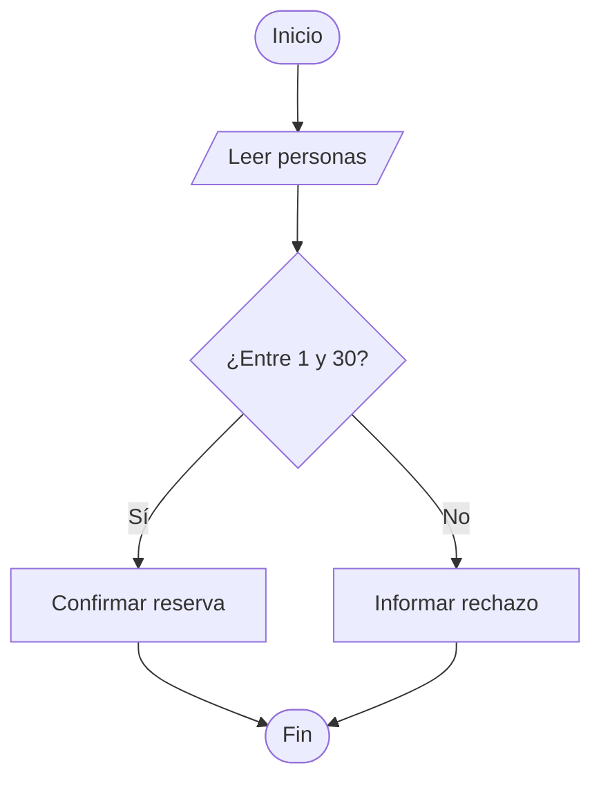

# U1_02 · Pseudocódigo y diagramas de flujo

[Anterior](../../unidad1/01-problemas-y-algoritmos/README.md) · [Índice de la unidad](../README.md) · [Inicio](../../README.md) · [Siguiente recurso](../../unidad1/03-variables-y-constantes/README.md)

## Objetivo

Representar una regla con una notación consistente antes de implementarla.

Tema: **Clarificar el problema mediante acciones algorítmicas**.

## Problema y contrato

Para reservar una sala, un grupo debe tener entre 1 y 30 personas. Representaremos la validación y la decisión sin depender de botones o de un editor concreto.

## Conceptos necesarios

El pseudocódigo expresa la solución con instrucciones legibles, pero no tiene una sintaxis universal. Por eso el curso declara sus convenciones: `←` asigna; `=` compara en pseudocódigo; `DIV` divide enteros; `MOD` obtiene residuo; las posiciones comienzan en cero. En Java, la asignación se escribe `=` y la comparación de valores primitivos `==`.

Un diagrama de flujo muestra caminos: inicio/fin, entrada/salida, proceso y decisión. Cada decisión debe tener condiciones de salida claras. Una rama sin destino o un ciclo sin actualización puede revelar un diseño incompleto.



El diagrama y el pseudocódigo deben expresar la misma regla. No son decoraciones posteriores. La implementación agrega detalles del lenguaje sin cambiar los casos aceptados.

## Diseño en pseudocódigo

La notación expresa la solución y no se ejecuta directamente como Java o PSeInt. Consulta las [convenciones del curso](../../docs/pseudocodigo-y-pruebas.md).

```text
Leer personas
Si personas >= 1 Y personas <= 30 Entonces
  Mostrar "Reserva permitida"
SiNo
  Mostrar "Cantidad fuera de rango"
FinSi
```

Relaciona cada paso con una entrada, una validación, un cambio de estado o una salida. Predice el resultado antes de ejecutar.

## Implementación completa

Archivo [Main.java](Main.java). Las clases de apoyo del ejemplo están en el mismo archivo para que puedas ejecutarlo sin dependencias externas. Cada carpeta es independiente; no combines todos los Main como una misma aplicación.

```java
public class Main {
    public static void main(String[] args) {
        int personas = 30;
        if (personas >= 1 && personas <= 30) {
            System.out.println("Reserva permitida");
        } else {
            System.out.println("Cantidad fuera de rango");
        }
    }
}
```

## Ejecutar paso a paso

1. Prepara JDK 21 según tu sistema en la [guía de ambiente](../../docs/ambiente-y-herramientas.md). Si todavía no descargaste el curso, consulta [cómo estudiar en GitHub](../../docs/como-estudiar-en-github.md).
2. Abre PowerShell en Windows o Terminal en Ubuntu/macOS en la raíz del repositorio.
3. Entra a esta carpeta:

```bash
cd unidad1/02-representar-la-solucion
```

4. Ejecuta el archivo:

```bash
java Main.java
```

5. Compara el resultado con el esperado. Para repetir después de modificar, guarda el fuente y vuelve a ejecutar desde la misma carpeta.

Los comandos de Java son los mismos en los tres sistemas. Si compilas por separado, usa las instrucciones de la guía. No necesitas Maven, servidores ni una base de datos.

## Resultado esperado

```text
Reserva permitida
```

## Prueba de escritorio y recorrido

La condición incluye ambos extremos. Con personas = 30, ambas comparaciones son verdaderas y se recorre la rama Sí. Solo un mensaje se imprime.

Escribe una tabla con instrucción, valor anterior y valor nuevo de las variables que cambian. Para arreglos o matrices, anota también el índice y la celda visitada. La tabla debe explicar cómo se obtiene la salida, no solo repetirla.

## Errores frecuentes

Usar OR en lugar de AND aceptaría cantidades fuera del rango. Copiar un símbolo de pseudocódigo a Java puede producir un error de sintaxis. Un diagrama ambiguo no mejora por agregar colores.

## Práctica

Predice y ejecuta 0, 1, 30 y 31. Cambia temporalmente && por || y explica qué entradas inválidas pasan. Restaura la regla.

Antes de ejecutar, registra entrada, resultado esperado y razón. Después agrega resultado observado. Si hay diferencia, localiza la primera instrucción cuyo estado se aparta de tu predicción. Cambia una regla a la vez para identificar su efecto.

<details>
<summary>Orientación de solución (consulta después de intentarlo)</summary>

0 y 31 se rechazan; 1 y 30 se aceptan. Con OR, 0 cumple <=30 y 31 cumple >=1: ambos serían aceptados. La regla requiere las dos condiciones simultáneamente.

</details>

## Explica con tus palabras

¿Qué representa cada salida del rombo? ¿Por qué declaramos las convenciones del pseudocódigo?

## Evidencia de aprendizaje

Conserva tu código modificado, una tabla de casos y una explicación de la decisión aplicada. Incluye un caso habitual, una frontera y un rechazo cuando el contrato lo permita. Debes poder justificar tanto el resultado como los límites de la solución.

[Anterior](../../unidad1/01-problemas-y-algoritmos/README.md) · [Índice de la unidad](../README.md) · [Inicio](../../README.md) · [Siguiente recurso](../../unidad1/03-variables-y-constantes/README.md)
